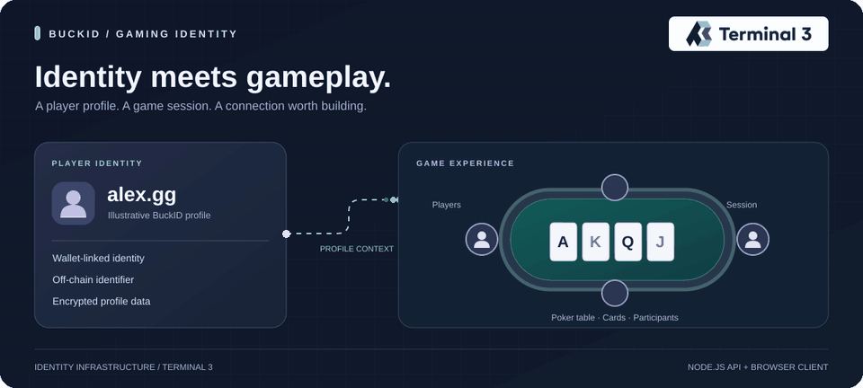
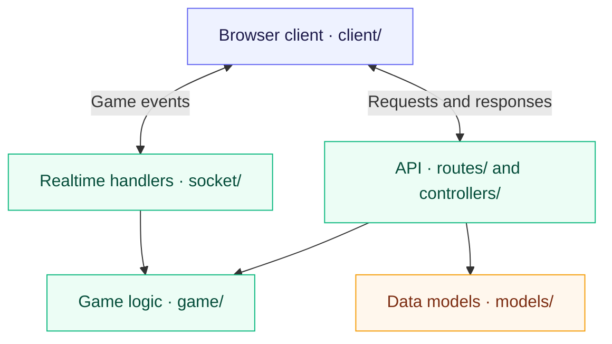

<p align="center">
  
</p>

<h1 align="center">BuckID</h1>

<p align="center">
  <strong>One gaming identity. A connected player experience.</strong><br>
  A wallet-linked identity concept alongside a Node.js gaming application.
</p>

<p align="center">
  
  
  
  
</p>

<p align="center">
  <a href="#the-idea">The idea</a> ·
  <a href="#quick-start">Quick start</a> ·
  <a href="#application-layout">Application layout</a> ·
  <a href="#project-map">Project map</a> ·
  <a href="#commands">Commands</a>
</p>

---

## The idea

A player’s identity can extend beyond a single game session. BuckID gives BeraBucks users a wallet-linked profile and a unique `.gg` username, providing a shared identity for supported gaming experiences.

| Identity | Participation | Privacy |
| :--- | :--- | :--- |
| A recognizable profile, such as `alex.gg`, linked to a Web3 wallet. | Supported experiences can associate activity and holdings with that profile. | Terminal 3 provides off-chain decentralized identifiers, encrypted profile data, and verifiable credentials. |

These capabilities are described in [Terminal 3’s BuckID announcement](https://blog.terminal3.io/terminal-3-powers-buckid-decentralized-user-profiles-for-gamers-on-berabucks/).

### Where this application fits

This repository contains the client and Node.js server for the gaming application. The poker illustration introduces how a player profile could relate to a game session, its table, and its participants.

> **Integration scope**
> The overview illustrates the BuckID concept. It does not establish that this repository implements wallet authentication, Terminal 3 credential verification, cross-game rewards, or blockchain transactions. Confirm those features against the source code and configured services.

## Quick start

### 1. Prepare your environment

Use **Node.js 24 or newer** and **npm**. Check the repository’s `.nvmrc` for its selected Node.js version.

```bash
node --version
npm --version
```

### 2. Install dependencies

Run both commands from the repository root:

```bash
npm install
npm install --prefix client
```

### 3. Start development

```bash
npm run dev
```

This command starts the API and client together.

| Service | Local address | Purpose |
| :--- | :--- | :--- |
| **App** | [localhost:3000](http://localhost:3000) | Open the game in your browser. |
| **API** | [localhost:5001](http://localhost:5001) | Backend service address; individual routes depend on the implementation. |

Stop the development processes with `Ctrl+C`.

## Application layout

The repository separates the browser client from the server’s request handling, game logic, and socket-related code.



*Conceptual module map based on the directory structure. Exact dependencies and event flows are defined by the code.*

## Project map

| Path | Area |
| :--- | :--- |
| [`client/`](client/) | Frontend application. |
| [`server.js`](server.js) | Server entry point. |
| [`routes/`](routes/) | API route definitions. |
| [`controllers/`](controllers/) | Request handling. |
| [`middleware/`](middleware/) | Shared request processing. |
| [`game/`](game/) | Game-specific logic. |
| [`socket/`](socket/) | Realtime event handling. |
| [`models/`](models/) | Data model definitions. |
| [`config/`](config/) · [`config.js`](config.js) | Configuration code. |
| [`utils/`](utils/) | Shared utilities. |
| [`package.json`](package.json) | Root dependencies and npm scripts. |
| [`package-lock.json`](package-lock.json) | Root dependency lockfile. |
| [`.nvmrc`](.nvmrc) | Selected Node.js version. |

## Commands

Run these commands from the repository root.

| Command | Result |
| :--- | :--- |
| `npm run dev` | Starts the API and client together. |
| `npm run start:backend` | Starts the backend on port `5001`. |
| `npm run start:frontend` | Starts the client on port `3000`. |
| `npm run build` | Builds the client for production into `client/build`. |

### Build the client

```bash
npm run build
```

The build produces the frontend bundle. Hosting that bundle and running the backend require deployment configuration for your environment.

## Configuration

Review [`config.js`](config.js), [`config/`](config/), and the scripts in [`package.json`](package.json) before running against external services. Required values depend on the implementation.

Keep private service credentials on the server and out of version control. Values bundled into the browser client are public.

<details>
<summary><strong>Local development troubleshooting</strong></summary>

| Symptom | Check |
| :--- | :--- |
| A dependency cannot be found | Install dependencies in both the root and `client/`. |
| A port is already in use | Stop the process using `3000` or `5001`, or update the relevant configuration. |
| The client opens but API requests fail | Confirm the backend is running, then check the client’s API address and server logs. |
| Installation reports a Node.js mismatch | Compare `node --version` with `.nvmrc` and the package engine requirements. |
| An external service fails to initialize | Check its required configuration and the backend startup logs. |

</details>

## Explore the ecosystem

| Resource | Learn more |
| :--- | :--- |
| [Terminal 3](https://terminal3.io/) | Identity and data infrastructure. |
| [BuckID announcement](https://blog.terminal3.io/terminal-3-powers-buckid-decentralized-user-profiles-for-gamers-on-berabucks/) | Published details of the BeraBucks identity integration. |
| [BeraBucks](https://berabucks.com/) | The gaming community platform associated with BuckID. |

---

<p align="center">
  <strong>BuckID</strong><br>
  A shared identity for supported gaming experiences.
</p>

<!-- Maintainer note: Commands and ports follow the supplied project brief. Before publishing, verify them against package.json and server/client configuration. Confirm directory descriptions and integration scope against the source. Keep assets/readme/ with this README. The hero GIF animates the conceptual connection; it does not report live application activity. -->
